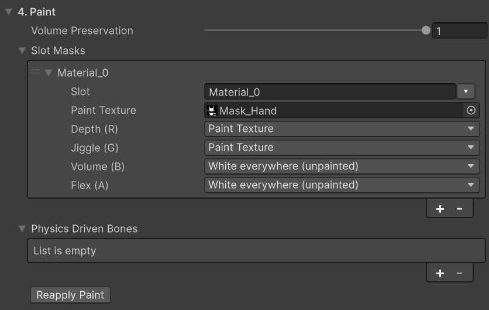

# Painting

Slot paint tells the bake how the material differs from place to place on a mesh. You paint one RGBA texture per material slot in that slot's UV0 layout. Its four channels each hold one property of the material. White means unpainted in every channel. A mesh with no paint counts as white everywhere. The mesh's vertex colors are not read.

## The four channels {#the-four-channels}

Each entry of **Slot Masks** (category 4. Paint) has a **Slot**, one **Paint Texture** and four channels. The channels have fixed places.

| Channel | Painted brightness | Used for |
|---|---|---|
| Depth (R) | **White** all flesh down to the rigid core **Gray** the bone is that much closer to the skin. The flesh is thinner, jiggles less and the dent is narrower **Black** bone right under the skin. It does not dent or jiggle, and a bulge does not spread past it | Places where the bone is closer to the skin than the skeleton's bones are: ribs, shins, the head. Paint bone in this channel only. |
| Jiggle (G) | **White** soft flesh that jiggles and gets pushed as a lump **Gray** firmer flesh. Half brightness gives about half the jiggle **Black** flesh as hard as bone. It does not jiggle, but it dents | Flesh whose firmness differs by area, such as a belly over muscle and a soft belly fat |
| Volume (B) | **White** flesh that keeps its volume. A bulge rises around the dent **Gray** a denser foam **Black** foam that compresses in place. The dent has a crisp edge and nothing bulges | A part in another material, such as a jelly toy on a foam base |
| Flex (A) | **White** bare flesh that bends freely **Gray** the darker, the stiffer it bends. The press spreads wider and the edge gets rounder **Black** a rigid plate. It sinks and tilts as one piece ([Plates](#plates)) | Leather, a tight suit, metal plates, gems, buckles, the pips of a soft die |

Each channel picks where it reads from. **Paint Texture** (the default) reads the channel from the texture. <strong>White everywhere (unpainted)</strong> and **Black everywhere** set the whole slot to one value, with no texture. If you pick Paint Texture and the slot has no texture, it is white.

- Volume (B) multiplies the authoring asset's **Volume Preservation** (4. Paint). With that value at 0, painting Volume has no effect. Volume changes the width and edge of a dent; the bulge around it shows only when Contact Detail is Full.
- Flex works only when **Contact Detail** is Full. With Basic, a Flex-painted area presses like bare flesh, and the Console says so when Play starts.
- If the whole surface has the same taut skin, use **Skin Tension** on the Softbody component instead of paint.
- While playing, **Volume Offset** and **Flex Offset** on the Softbody component add to the paint so you can try values ([Softbody Component](./Softbody-Component)).

The bake reads all four channels when it measures the flesh, so they apply with **Run Bake**. **Reapply Paint** runs Run Bake for you when the paint changed after the flesh was measured (it takes a few minutes). Once the asset has Baked Data, saving the Paint Texture file or changing its import settings applies the paint again automatically.

## Making the paint texture {#making-the-paint-texture}

1. In the texture import settings, turn off **sRGB (Color Texture)**. If it is on, gray reads darker (0.5 becomes 0.21). A warning and a **Turn Off sRGB** button appear on the Slot Masks entry.
2. Add an entry to **Slot Masks** and choose the material slot in **Slot**.
3. Assign **Paint Texture**. Leave channels you did not paint at <strong>White everywhere (unpainted)</strong>.
4. Press **Run Bake**.

The texture is read as follows.

- The bake reads the original image file, not the imported texture. So import settings such as compression, Max Size and mipmaps do not change the paint values; only sRGB does. 16-bit PNG, EXR and HDR are read as painted, regardless of sRGB.
- PNG, JPG and TGA are read directly; other formats such as PSD or TIF are briefly reimported without compression to be read (your import settings are not changed).
- Paint is read once per vertex, at that vertex's UV0 position. Detail finer than the vertex spacing is not seen. Bleed the paint out past the UV island borders.
- A texture without an alpha channel has Flex white (bare flesh).
- An entry whose **Slot** is not a slot name of the Target Mesh logs a warning and is skipped. If the same slot is entered twice, only the first entry is used. A slot with no entry counts as unpainted. Slot names come from [Slot Names](./Baking#_1-target).
- Clothing that sits within **Layer Max Gap** (2. Bake) of the skin takes Depth, Jiggle and Volume from the flesh below. Only Flex reads the clothing slot's own paint. So paint a buckle on clothing in the clothing slot's Flex.

### When the paint is not read as chosen {#paint-texture-problems}

The following warnings appear under the Slot Masks entry, in the Console during Run Bake and Reapply Paint, and in [Validate](./Baking#validate). The bake still finishes.

| Warning | Cause | Fix |
|---|---|---|
| `Paint texture X has sRGB on` | sRGB is on in the texture, so gray reads darker. | Press **Turn Off sRGB** or turn off sRGB in the import settings. |
| `Slot 'S': Depth reads channel ... which is black everywhere` | The channel it reads is black over the whole texture, so the whole slot becomes bone (Depth), flesh as hard as bone (Jiggle) or foam (Volume). For Flex, the whole slot is baked as one plate. | If you do not use that channel, set it to White everywhere. |
| `Slot 'S': its Paint Texture has no source pixels` | The original image file could not be read, so that slot stays white (unpainted). | Restore the original file and reimport the texture. |

## Plates {#plates}

Hard surfaces (hard parts) are painted with Flex. Each connected area painted darker than white is one piece, and each piece becomes one of the following. This runs only when **Contact Detail** is Full.

- **Rigid plate:** does not bend; sinks and tilts as one piece and pushes the flesh below. A piece painted black is a plate regardless of size. A gray piece also becomes a plate if it is small, because a piece that is small compared with the painted stiffness moves as one body, like a coin set in tough leather.
- **Bending piece:** any other gray piece bends as painted.

Lowering **Flex Offset** on the Softbody component increases the number of pieces that become plates, and at -1 every painted piece becomes a plate. A separate part not attached to the body (something resting on the surface, like a gem) is always a plate and moves resting on the flesh below.

- This differs from Depth 0. A place with Depth 0 stays where it is, and a plate moves over the flesh below.
- Paint black only the parts that keep their shape under a finger. Paint ribbons, cords and bands made of cloth gray, or leave them unpainted. A part hanging from a physics bone moves with that physics.
- A plate sits on the cells of the contact map, so the slot the plate sits on must be in **Pressable Slots**.

Whether a piece became a plate, and if not why, is written for each piece in the `Flex plates:` line of the Console after Run Bake.

| Log | Cause | To make it a plate |
|---|---|---|
| `painted pieces wrap around the body` | It wraps around the body (a ring around the neck, a band around the thigh) | Leave thin white gaps in the paint to split it into flat pieces. |
| `have no contact map cells under them` | There is no surface under it to press | Put the slot under it in **Pressable Slots**, or place the decoration close to the skin. |
| `cover more than ...` | The piece is too large | Leave thin white gaps and paint it as smaller pieces. |
| `sit at the very edge of the contact map` | It touches the edge of the contact map | Rebake with a different **Contact Map Resolution**. |

## How much it jiggles {#how-much-it-jiggles}

Jiggle sets the difference between areas, and the overall size is set by **Inertia Amount** on the Softbody component. The bake scales the jiggle so that flesh thicker than 3 cm painted white in Jiggle (the reference flesh) sags exactly by Inertia Amount at 1 g. So the same Inertia Amount is the same flesh on any mesh. Firmer or thinner areas move less than that.

With **Flesh Reach** (3. Rigid Core (Bones)) at 0, the deeper the flesh the more it jiggles, so a belly with no bone jiggles much more than other areas painted with the same brightness. For a human-sized body use about 3 ([Baking](./Baking#flesh-reach)). The bake warns in the Console in two cases.

- When the flesh of a Softbody slot barely moves: check that Depth or Jiggle over soft flesh is not black.
- When the deepest flesh moves several times more than the reference flesh: set Flesh Reach to about 3 and press Run Bake.

## Physics Driven Bones {#physics-driven-bones}

In **Physics Driven Bones** (4. Paint), put bones that another jiggle system already moves, such as spring bones, cloth or physics components. Flesh skinned to those bones and the bones below them loses Softbody jiggle in proportion to the skin weight. A vertex with half weight on a listed bone loses half of the jiggle. This happens after the scaling above, so adding a jiggle bone does not make the rest of the body jiggle more.

- It applies with **Reapply Paint** alone (Run Bake is not needed).
- A bone name that is not in the skeleton logs a warning and is skipped. If the mesh has no skin weights, the whole list is skipped.
- If the jiggle changes sharply within a narrow band, it warns and gives the mesh position. Such places can tear or fold while jiggling. Make the skin weights of those bones fall off wide and gently.

## Workflow and examples {#workflow-and-examples}

Start without paint. Press Run Bake, press the mesh in Play, and paint only the places that look wrong.

- **Character.** Paint places where the bone is close to the skin, such as hands, feet and head, darker in Depth. Paint firm flesh, such as a belly or thighs over muscle, gray in Jiggle. A skeleton without rib or pelvis bones treats the whole torso as thick flesh hanging from the spine, and **Bone Thickness** does not help there either. Paint that area darker in Depth, set Flesh Reach to about 3 and press Run Bake.
- **Clothing and decoration slots.** Do not paint Depth with the rules for the body. Painting Depth 0 on clothing or decoration makes that part bone. Leave these slots without an entry, or set them to White everywhere.
- **Body suit or leggings.** There is nothing to paint. The clothing vertices take Depth, Jiggle and Volume from the flesh below as they are.
- **Foam block or sponge.** There is nothing to paint. Set **Volume Preservation** (4. Paint) to 0.
- **A mesh with only part in another material** (a jelly toy on a foam base, the yolk and white of a halved egg). Set Volume (B) of the foam-side slot to Black everywhere. No texture is needed.

If paint seems to have no effect, see [Troubleshooting](./Troubleshooting).
