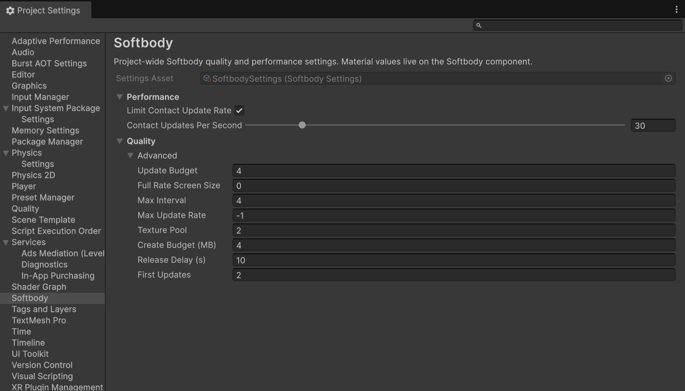
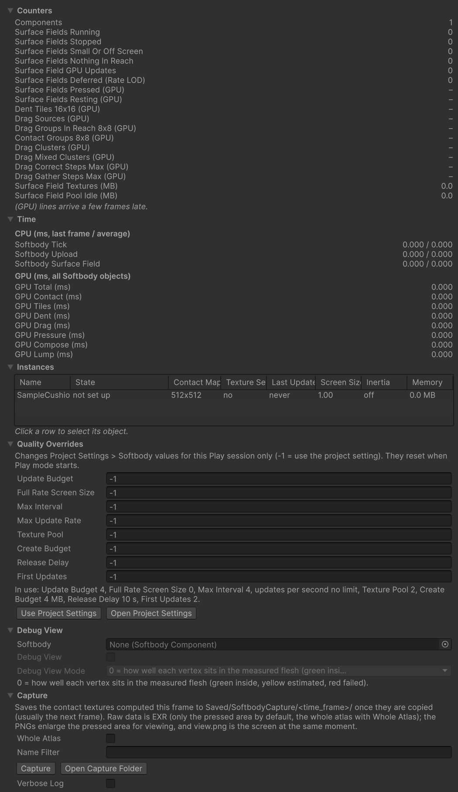

# Performance

Contact uses GPU time and memory only on meshes that are touched. Measure your own scene with the [Softbody Debugger](./Project-Settings#softbody-debugger) and the Unity Profiler.

## Where the cost goes {#where-the-cost-goes}

| Cost | Content | When |
|---|---|---|
| GPU time | One contact update | For each touched mesh, every frame unless the limits below skip it |
| CPU time | The component's LateUpdate: finding colliders, inertia, update requests | Every frame for each enabled component (small) |
| Memory | One set of contact textures. The size follows **Contact Map Resolution** | For each touched mesh, from the first touch until it has fully recovered |
| Memory | The contact map texture in Mesh Data | Always, while the Mesh Data is in memory |

Jiggle (inertia) is separate. Whether or not the mesh is touched, each component costs a small CPU calculation, and the vertex stage of the Softbody shader does some work.

## Life cycle {#life-cycle}

1. **Sleeping.** No collider is near the pressable surface. There is no texture set and no GPU work. With **Find Colliders Automatically** on, while the mesh is on screen and larger than **Min Screen Size**, one overlap check per frame still looks for colliders.
2. **First touch.** The mesh gets a texture set from the pool and updates that same frame. The update rate limit and the update interval for small meshes (**Full Rate Screen Size**) do not apply, and it goes first in the **Update Budget** order. If the pool has no ready set, it starts a few frames late.
3. **Pressed.** It updates once per frame. If a limit below applies, it updates less often. Updates do not stop while it stays pressed and nothing moves.
4. **Recovering.** After the hand leaves, updates continue while the dent returns according to **Recovery Rate**. With **Memory Time**, they continue until the mark disappears (about 10 times **Memory Fade Time**).
5. **Recovered.** If nothing is within reach, the texture set is emptied and returned to the pool, and the mesh sleeps again. A mesh off screen does not wait for an update turn; it counts as recovered once time has passed.

## What makes it cheaper {#what-makes-it-cheaper}

| Setting | Where | Effect |
|---|---|---|
| [**Enable Contact**](./Softbody-Component#enable-contact) off | Softbody component, Contact | Removes all contact cost (GPU work, memory, collider search) for characters nobody touches, such as a crowd, and keeps jiggle. Can be changed during Play. |
| **Contact Map Resolution** | Softbody Authoring Data, 6. Contact Map | Sets the size of every update and texture set, and applies after you press **Rebake Contact Map**. 512 for a human-sized character, 1024 only when seen up close, 256 for small props. |
| **Pressable Slots** | Softbody Authoring Data, 6. Contact Map | Leaving out slots that do not dent (face, hair) gives the map's cells to the rest, so a lower resolution can look just as sharp. |
| [**Min Screen Size**](./Softbody-Component#min-screen-size) | Softbody component, Contact > Performance | Stops the dent calculation when the mesh appears smaller than this value on screen or is in no camera. At the default 0.15 with a 90° horizontal field of view, a human-sized character stops at about 12 m. During Play the Scene view counts as a camera. |
| **Limit Contact Update Rate** and **Contact Updates Per Second** | Project Settings > Softbody, Performance | Limits the updates per second of each touched mesh. 30 per second at 120 fps is a quarter of the GPU time, and at 60 fps half. |
| **Update Budget** | Project Settings > Softbody, Quality > Advanced | Limits the number of meshes updated in one frame (default 4). The rest update in turn ([Project Settings](./Project-Settings#update-budget)). |
| **Full Rate Screen Size** | Project Settings > Softbody, Quality > Advanced | Updates meshes that look small on screen only once every few frames. The default 0 is off. |
| **Collider Channel** | Softbody component, Contact > Colliders | Choosing only the layers that hold hands and props reduces the collider candidates ([Colliders](./Colliders)). |
| **Softbody Ignore** component | Any GameObject | Attach it to things that overlap the mesh but must not press it. Colliders on that object and its children are skipped. |
| [**Tessellation**](./Materials#tessellation) off, or a large **Edge Length** | Material | Tessellation also splits pressable triangles while they are not pressed, so drawing costs more. Use Softbody/Lit for meshes that are not seen up close. |
| [**Contact Detail**](./Softbody-Component#contact-detail) Basic (default) | Softbody component, Contact | Leaves out bulge, skin drag, Edge Smoothing and Flex paint, so it costs less GPU time than Full. Set Full only on meshes seen up close. |

Disabling the component or the GameObject returns the texture set to the pool and stops jiggle and updates. Until you enable it again there is neither CPU cost nor GPU contact cost; the material stays at the disabled values, which leaves a small amount of work in the vertex stage of the Softbody shader. The returned set is freed after **Release Delay** (default 10 seconds), and the contact map in Mesh Data stays in memory.

## Graphics APIs {#graphics-apis}

| API | First compile of the contact shaders | Notes |
|---|---|---|
| Direct3D 12 | A few seconds | Recommended for the Editor. |
| Vulkan | A few seconds | |
| Direct3D 11 | About 15 minutes (on a fast PC) | The compiled result stays in the project's Library folder, so you do not wait again until you delete Library. |
| Metal | Not checked | **Contact Detail** Full runs as Basic. |

On APIs other than these four (OpenGL, OpenGL ES, WebGL) and on devices without compute shaders, contact is off and only jiggle runs. The Console then shows the warning `Contact is OFF for every Softbody component: ...` with the reason.

## Measuring with the Debugger and Profiler {#measuring}

Each line is described in [Project Settings](./Project-Settings#softbody-debugger). The GPU lines are the sum over all touched meshes.

In the Time section of the Debugger, look at **GPU Total (ms)** first. If it is high, look in the Counters section at **Surface Field GPU Updates**, the number of meshes updated, and **Dent Tiles 16x16 (GPU)**, the number of cell groups that solve the dent. Then look at the GPU lines that add up to GPU Total.

- GPU Contact grows with the number of colliders and [shape field](./Colliders#shape-fields) pieces, and with Contact Groups 8x8 (GPU), which is fixed per mesh.
- GPU Dent grows with the pressed area.
- GPU Tiles and GPU Compose are nearly constant per mesh. GPU Lump is 0 on meshes without lumps (all static meshes included).
- GPU Drag and GPU Pressure run only with **Contact Detail** Full. With Basic, or with **Drag Friction** at 0, the GPU Drag and Drag lines are 0.

If Surface Fields Running is high with nothing visibly touching, a mesh is recovering or something on a **Collider Channel** layer is gathering as a collider. Find the mesh in the State column of the Instances list.

In the Unity Profiler they appear under these names.

- CPU module (Scripts): **Softbody Tick** is the whole LateUpdate of each component. Inside it are **Softbody Surface Field** (preparing the contact update: colliders, bones, requests) and **Softbody Upload** (passing inertia data and material values).
- GPU module: **Softbody Contact**, **Softbody Tiles**, **Softbody Dent**, **Softbody Compose**, **Softbody Lump**, and with Full **Softbody Drag** and **Softbody Pressure**. These are the same spans as the GPU lines of the Debugger.
- The GPU updates of all meshes are submitted once per frame in the `SoftbodyFlush` step at the start of PostLateUpdate.

While the Debugger is open or the Profiler is recording, a small extra task reads the contact state a few frames late to fill the (GPU) lines.

## Memory {#memory}

The size of one texture set follows **Contact Map Resolution** and whether the mesh has lumps. The **Memory** column of the Instances list in the Debugger shows each mesh, **Surface Field Textures (MB)** all touched meshes, and **Surface Field Pool Idle (MB)** the spare sets in the pool and the sets being prepared. On Vulkan some contact textures use a larger format, so the same mesh needs more memory. Memory grows with the number of meshes touched at the same time, not with the number of meshes placed.

The baked shape of a [shape field](./Colliders#shape-fields) is uploaded to the GPU once for each mesh that shape field presses. One hand baked with 0.2 cm cells is about 1 MB. It is released when the pressed mesh returns its texture set to the pool.

The contact map texture in Mesh Data is stored in the Mesh Data and stays loaded while a scene or prefab that uses the Mesh Data is in memory. Disabling the component does not unload it.

Disabling and enabling a component, spawning it or loading a scene does no heavy work in that frame. Textures are created at **Create Budget** per frame, and the pool keeps **Texture Pool** spare sets for each kind used by enabled components, so the first touch does not wait. What a disabled component used stays for **Release Delay**, so enabling it again recreates nothing, and after that it is released a little each frame. With Texture Pool at 0 no spares are kept (the first touch starts a few frames late); raise it if several meshes are touched at once. The three values are in [Project Settings](./Project-Settings#quality).
