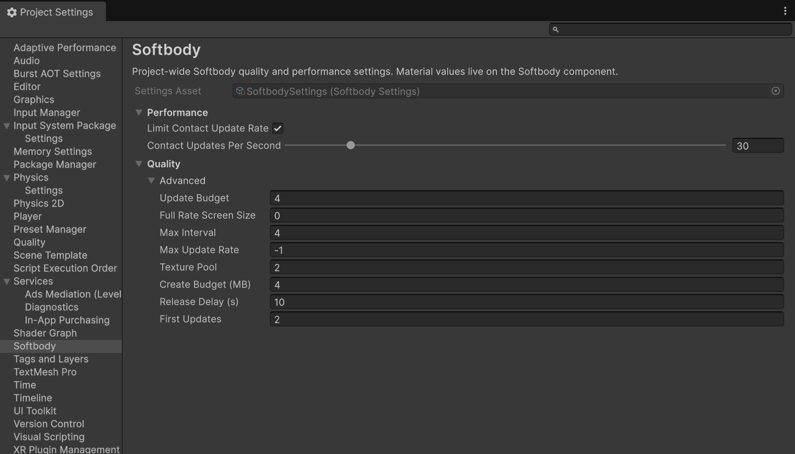
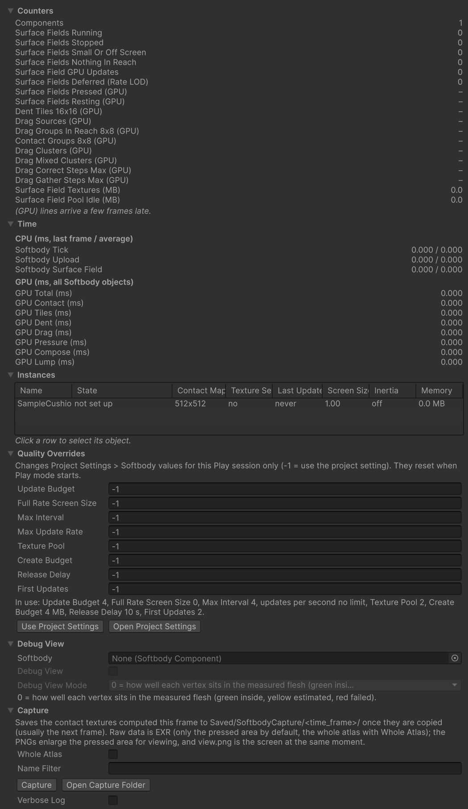

# Project Settings {#page-top}

The fields in Project Settings > Softbody, the Softbody Debugger window, the debug views, and the logs. What to look at first is in [Performance](./Performance#measuring).

## Project Settings > Softbody {#project-settings}

Project-wide quality and performance settings. Material values are not here; they are on the [Softbody component](./Softbody-Component).

Values are stored in the `SoftbodySettings` asset in a `Resources` folder. Without the asset, the plugin runs on defaults and the fields appear dimmed. **Create Settings Asset** creates `Assets/Resources/SoftbodySettings.asset`. To be included in a build, the asset must be inside a `Resources` folder and be named `SoftbodySettings`. If you pick a settings asset with another name or location, the inspector warns that the asset is not used.

Changed values are saved when you leave this screen. Changes made during Play take effect immediately and stay in the asset. To test only for the current Play session, use the Debugger's [Quality Overrides](#quality-overrides).



### Performance {#performance}

| Field | Default | What it does |
|---|---|---|
| **Limit Contact Update Rate** | Off | Recomputes dents for each touched mesh at most **Contact Updates Per Second** times per second, regardless of frame rate. Between updates, the dented area keeps its last shape and moves with the mesh, so a fast hand can leave a trail of one update interval. |
| **Contact Updates Per Second** | 30 | Updates per second when Limit Contact Update Rate is on. 5 to 240. |

### Quality {#quality}

All are under **Advanced** in the Quality section. The moment a contact starts, the mesh is always updated immediately, regardless of screen size or the update rate limit.

| Field | Default | What it does |
|---|---|---|
| [**Update Budget**](#update-budget) | 4 | Maximum number of meshes whose contact is updated in one frame. 0 = no limit. |
| [**Full Rate Screen Size**](#full-rate-screen-size) | 0 | Meshes smaller than this value on screen are updated at intervals instead of every frame. 0 = every frame. |
| **Max Interval** | 4 | Maximum interval (in frames) between updates of a small mesh. With the default, 15 Hz at 60 fps. |
| [**Max Update Rate**](#max-update-rate) | -1 | Maximum updates per second for a touched mesh. -1 = follow Limit Contact Update Rate, 0 = no limit. |
| [**Texture Pool**](#texture-pool) | 2 | Number of spare contact texture sets kept for each kind. |
| [**Create Budget**](#create-budget) | 4 MB | Maximum memory of contact textures created and released in one frame. 0 = no limit. |
| [**Release Delay**](#release-delay) | 10 s | How long contact textures and similar data stay in memory after their last use. 0 = start releasing immediately. |
| [**First Updates**](#first-updates) | 2 | Maximum number of meshes that do their first update in one frame. 0 = no limit. |

#### Update Budget {#update-budget}

Meshes that do not fit in the budget wait for their turn and catch up on all the movement in one step at the next update. The update order is:

1. Meshes that were just touched
2. Meshes that are visible on screen and have a collider within reach, or that have waited **Max Interval** frames
3. Meshes that are visible on screen and recovering after the hand left
4. Meshes off screen

Within the same turn, meshes that appear larger on screen and have waited longer go first.

#### Full Rate Screen Size {#full-rate-screen-size}

Screen size is the diameter of the bounding sphere relative to the screen height, roughly 0 to 1. A mesh smaller than this value is updated only once every ceil(this value / screen size) frames. The interval is at most **Max Interval**.

#### Max Update Rate {#max-update-rate}

If not -1, it takes precedence over Limit Contact Update Rate and Contact Updates Per Second above. For example, at 120 fps a value of 30 updates each mesh once every four frames.

#### Texture Pool {#texture-pool}

Kinds are divided by contact map resolution, with or without lumps, and coarse grid size (a grid that merges several contact map cells into one). A mesh receives a set when it is first touched, and returns it (emptied) when it has fully recovered with no touching collider. While a component that uses a kind is enabled, spares are created a little each frame (**Create Budget**), so the first touch does not wait. Sets beyond this number, and spares of kinds that no enabled component uses any more, are released after **Release Delay**.

#### Create Budget {#create-budget}

A texture counts as at least 0.5 MB, and at least one texture is created every frame. Enabling many meshes at once or touching them at the same time does not cause a hitch; the work is spread over several frames. A mesh waiting for a texture starts to dent a few frames late, while its jiggle runs immediately.

#### Release Delay {#release-delay}

Contact textures and the lookup tables of disabled meshes (the per-mesh tables made by the first update) stay in memory for this long after their last use. If the mesh is enabled again within this time, nothing is created again; after it, they are released a little each frame. GPU work stops immediately either way. It counts real time, so it runs during pause or at Time Scale 0.

#### First Updates {#first-updates}

The first update is the first update after enabling, spawning, or scene loading, and it builds the mesh's lookup tables. The remaining meshes start one or two frames later. Meshes enabled again within **Release Delay** still have their tables and are not counted.

## Quality levels {#quality-levels}

The values in Project Settings > Softbody are shared by all Quality levels. To differ per level, change `SoftbodySystem.Overrides` in code. Its names match the eight Quality fields; -1 uses the settings value, and 0 or higher takes precedence over it. They all reset to -1 when the app starts (in the editor, when Play starts), so set them again after starting and when the Quality level changes.

```csharp
using Softbody;
using UnityEngine;

// At the lowest Quality level, update at most two meshes per frame, and each mesh at most 30 times per second.
bool low = QualitySettings.GetQualityLevel() == 0;
SoftbodySystem.Overrides.UpdateBudget = low ? 2 : -1;
SoftbodySystem.Overrides.MaxUpdateRate = low ? 30f : -1f;
```

Per-mesh quality is set by the component's **Contact Detail** and **Min Screen Size** and the Softbody Authoring Data's **Contact Map Resolution** ([Performance](./Performance#what-makes-it-cheaper)).

## Softbody Debugger {#softbody-debugger}

Open it with **Window > Softbody > Debugger**. Values appear only during Play and are redrawn every 0.25 seconds. The sections are Counters, Time, Instances, Quality Overrides, Debug View, and Capture.



### Counters {#counters}

Rows marked (GPU) are read back from the GPU only while this window is open or the Profiler is recording, and lag by a few frames. A row shows `–` if no value has been read yet. The other rows are counted every frame, and one component can be in several rows. If some components cannot report their state yet, the line `N of M Softbody components cannot report their state yet` appears at the top.

| Row | What it shows |
|---|---|
| Components | Enabled Softbody components. |
| Surface Fields Running | Components with contact on that requested a contact update this frame. |
| Surface Fields Stopped | Components with contact on that did not request one. They are resting or not ready yet. |
| Surface Fields Small Or Off Screen | Not visible in any camera (Game, Scene view, VR) last frame, or smaller than **Min Screen Size**. |
| Surface Fields Nothing In Reach | A collider was found, but none is within reach. |
| Surface Field GPU Updates | Updates actually run on the GPU after the **Update Budget**. |
| Surface Fields Deferred (Rate LOD) | Requested, but postponed by the Update Budget, the update rate limit, or the screen size rule. |
| Surface Fields Pressed (GPU) | Meshes that had dented cells in the last result read back. |
| Surface Fields Resting (GPU) | No dented cells and recovery finished. The GPU skips every stage after the Contact stage. |
| Dent Tiles 16x16 (GPU) | 16x16 cell groups of the contact map that solve dents. |
| Drag Sources (GPU) | Cells that hold the skin for drag. Cheapest at 0. |
| Drag Groups In Reach 8x8 (GPU) | 8x8 groups of cells that drag reaches. |
| Contact Groups 8x8 (GPU) | 8x8 groups of cells where the Contact stage runs. |
| Drag Clusters (GPU) | 8x8 groups that contain drag sources. |
| Drag Mixed Clusters (GPU) | Of those, groups that span several pieces of the contact map. A high count means much drag crosses seams. |
| Drag Correct Steps Max (GPU) | The longest iteration one 8x8 group runs in the drag correction stage (over all meshes). |
| Drag Gather Steps Max (GPU) | The longest iteration one 8x8 group runs in the drag gather stage (over all meshes). |
| Surface Field Textures (MB) | Contact texture sets held by touched meshes. |
| Surface Field Pool Idle (MB) | Spares waiting in the pool and sets being created. |

The Drag rows are nonzero only when **Drag Friction** is above 0 at **Contact Detail** Full.

### Time {#time}

CPU rows show last frame's value / the 30-frame average (ms). GPU rows show the sum over all Softbody meshes for the frame the GPU finished last; stages that have not run for more than 0.5 seconds show 0. The names match the Unity Profiler markers.

| Row | What it shows |
|---|---|
| Softbody Tick | CPU time of all Softbody components' LateUpdate. Includes the next two rows. |
| Softbody Upload | CPU time passing this frame's results (inertia data, material values) to the material. |
| Softbody Surface Field | CPU time preparing contact updates (colliders, bones, requests). |
| GPU Total (ms) | Sum of the seven GPU rows below. |
| GPU Contact (ms) | The stage that measures where colliders press. |
| GPU Tiles (ms) | The stage that builds the list of contact map groups that have work. |
| GPU Dent (ms) | The dent stage. |
| GPU Drag (ms) | The drag stage (Contact Detail Full). |
| GPU Pressure (ms) | The contact pressure stage that draws the rise around a dent (Contact Detail Full). |
| GPU Compose (ms) | The stage that combines dents and lump shifts into the displacement the material reads, and also builds the normal slope and **Dent Darkening**. |
| GPU Lump (ms) | The lump stage. |

### Instances {#instances}

One row per enabled Softbody component. Clicking a row selects that object.

| Column | What it shows |
|---|---|
| Name | Hierarchy path and `(Softbody)`. |
| State | `not set up` (target mesh or Mesh Data does not match, so it does not run), `contact off` (contact is off, there is no contact map, or it cannot run on this GPU), `sleeping` (not requesting updates), `deferred` (requested but postponed this frame), `running` (updated on the GPU this frame). `(small or off screen)` or `(nothing in reach)` can follow. |
| Contact Map | Contact map resolution. `none` if absent. |
| Texture Set | Whether a contact texture set is currently held. |
| Last Update | Frame number of the last GPU update. `never` if none yet. |
| Screen Size | Bounding sphere diameter relative to the screen height. |
| Inertia | `off`, `on`, or the number of inertia groups. |
| Memory | Contact texture memory held by this mesh. |

### Quality Overrides {#quality-overrides}

Changes the eight [Quality](#quality) fields for the current Play session only. -1 uses the Project Settings value. Nothing is saved, and the values return to -1 when Play starts. The `In use:` line below shows the value currently in use. **Use Project Settings** resets all to -1, and **Open Project Settings** opens the settings screen. These are the same values as `SoftbodySystem.Overrides` in code ([Quality levels](#quality-levels)).

### Debug View {#debug-view}

Changes **Debug View** and **Debug View Mode** of the component in the **Softbody** field. Selecting an object with a Softbody component in the hierarchy updates the field. These are the same values as the Debug section in the component inspector.

During Play, Debug View shows debug colors instead of normal shading on Softbody materials (Softbody/Lit, or shaders that use the Softbody shader function). Debug View Mode can be changed only while Debug View is on.

- 0: How well each vertex sits inside the measured flesh (green = inside, yellow = estimated, red = failed).
- 1: Connection to the rigid core (cyan = connected, magenta = not connected).
- 2: Contact map checker. Overlapping clothes and buttons with the same pattern as the skin below dent together with the skin. Lines where the pattern breaks are seams.
- 3: Distance to the outer surface (green = on the surface, red = far outside, blue = deep inside, darkest at 10 cm).
- 4: Baked softness (navy = does not move, then green, red = softest, magenta = moves in the opposite direction).
- 5: Dent between vertices (green = reads dents inside the triangle, red = reads only at vertices along seams).


The component's **Contact Only (Debug)** turns off all jiggle and shows only contact. It is not for release.

### Capture {#capture}

Saves this frame's contact textures to `<project>/Saved/SoftbodyCapture/<date_time>_f<frame>/`. They are saved as soon as the copy finishes, usually the next frame, and only during Play.

- **Whole Atlas**: Saves the whole contact map instead of the dented region.
- **Name Filter**: Captures only objects or components whose name contains this text. If empty, all with contact on.
- **Capture**: Captures. **Open Capture Folder**: Opens the save folder.
- **Verbose Log**: See [Logs](#logs).

The folder contains EXR files with the raw values (dented region only, or the whole contact map with Whole Atlas), a PNG preview zoomed on the dented region, `view.png` (the screen at the same moment), and `capture.txt` (the contact settings at that moment). The result is also written to the Console. In builds, call `SoftbodyComponent.RequestCaptureAll()` or one component's `RequestCapture()` from code; files are saved under `Saved/SoftbodyCapture/` in `Application.persistentDataPath`.

## Logs {#logs}

All Softbody messages in the Console start with `[Softbody]`. Clicking a message from a component selects that component. Entering `[Softbody]` in the Console search field leaves only this plugin's messages.

- Info: bake results (inertia groups, lumps, etc.), one `setup valid (...)` line per component when Play starts, values that have no effect on this mesh (`... has no effect because ...`; in Play, only those changed from the default), and one GPU verdict line (`Contact is available on this GPU (...)`).
- Warning: settings that need fixing. A problem that repeats during Play appears only once per Play.
- Error: the bake or setup cannot run.
- `Contact is OFF for every Softbody component: ...` warning: contact cannot run on this GPU or graphics API. Jiggle still runs ([Performance](./Performance#graphics-apis)).
- `Contact Detail Full cannot run on this graphics device, so this mesh runs as Basic`: A mesh set to Full runs as Basic. Appears only on GPUs that cannot run Full (including Metal).

With **Verbose Log** (the Debugger's Capture section) on, detailed messages such as the one for when jiggle first moves are also written during Play. It turns on again each Play while the window is open.

The **Validate Setup** button in the component inspector (also in the component menu) runs the same checks without Play, and lists every value that has no effect on this mesh regardless of the default.
