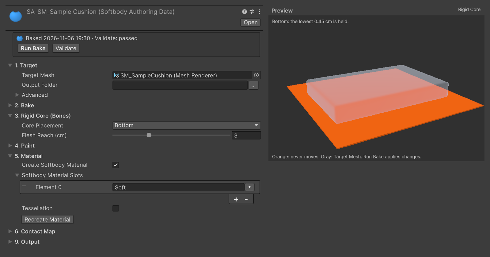
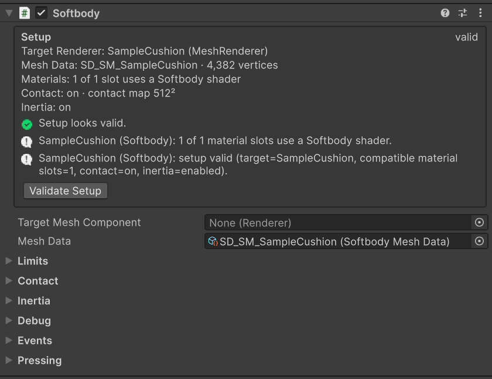

# Quick Start

Bake the sample cushion that comes with the package and drop a ball on it.

## 1. Import the sample {#_1-import-the-sample}

In the Package Manager, open the Samples tab of **MallangPhysics** and Import **Quick Start**. The following is copied to `Assets/Samples/MallangPhysics/<version>/Quick Start/`.

| File | |
|---|---|
| `SM_SampleCushion.fbx` | A 60 × 40 × 8 cm cushion with one material slot, `Soft` |
| `SampleCushion.prefab` | The cushion, and a Box Collider reaching from the floor to 2 cm below the top surface |
| `QuickStart.unity` | A cushion on a floor, a ball with a Rigidbody, a light and a camera |

The Box Collider is 2 cm lower than the top surface, so a ball that falls sinks 2 cm and leaves a dent immediately.

## 2. Set up the bake {#_2-set-up-the-bake}

Select `SM_SampleCushion.fbx` in the Project window and press **Assets > Softbody > Create Authoring Data**. `SA_SM_SampleCushion` is created next to the model, and **Target Mesh** is filled with the cushion. Set that asset as follows.

| Setting | Category | Value |
|---|---|---|
| **Target Mesh** | 1. Target | `SM_SampleCushion` (already filled) |
| **Core Placement** | 3. Rigid Core (Bones) | Bottom |
| **Create Softbody Material** | 5. Material | On |
| **Softbody Material Slots** | 5. Material | `Soft` |

Bottom holds only the bottom of the cushion that touches the floor, and the rest becomes flesh. In the Preview area at the bottom of the inspector, the orange part is the part that does not move.

If you created it with **Assets > Create > Softbody > Softbody Authoring Data**, drag `SM_SampleCushion.fbx` onto **Target Mesh**.

## 3. Bake {#_3-bake}

Press **Run Bake** (about 15 seconds for the sample). When it finishes, press **Validate** to check that there are no errors. The following are created next to the authoring asset.

- `SD_SM_SampleCushion`: the bake result. It goes into **Baked Data** (9. Output) of the authoring asset.
- `M_SM_SampleCushion_Softbody`, `MI_SM_SampleCushion_Soft`: the Softbody/Lit material and a variant for the `Soft` slot. The variant is applied directly to the `Soft` slot of the model.

The bake does not modify the mesh. The sample cushion has no texture, so the material is white.

## 4. Add the component {#_4-add-the-component}

Open `QuickStart.unity`, add a **Softbody** component to `SampleCushion`, and assign `SD_SM_SampleCushion` to **Mesh Data**. Leave **Target Mesh Component** empty. When empty, it uses the renderer on this object and its children that the Mesh Data was baked for.

## 5. Play {#_5-play}

Press Play. The ball falls and presses the cushion. Drag the ball in the Scene view and the dent follows it, and the place it left returns. Dents and jiggle are visible only during Play.

Every collider on a layer of **Collider Channel** (default: all layers except Ignore Raycast) presses the flesh, and triggers do not. The cushion's own Box Collider is under **Ignore Root** (the object with the component if there is no Animator), so it does not press. To change this, see [Colliders](./Colliders).

## Things to try {#things-to-try}

On the Softbody component (changes made during Play show immediately):

| Setting | Default | Value to try | |
|---|---|---|---|
| **Recovery Rate** | 30 | 8 | A dent takes about 0.5 s to return. |
| **Memory Time** | 0 s | 1.5 | Memory foam: the dent stays after the ball leaves, then fades. |
| **Skin Tension** | 0 | 0.5 | Leather: the dent is rounder and wider. |

On Softbody Authoring Data (4. Paint). Dents change immediately without baking again.

| Setting | Default | Value to try | |
|---|---|---|---|
| **Volume Preservation** | 1 | 0 | Foam: nothing rises and the edge of the dent is sharp. |

## Next {#next}

- [Baking](./Baking) your own mesh
- [Characters](./Characters) for skinned meshes
- All settings in the [Softbody Component](./Softbody-Component)
