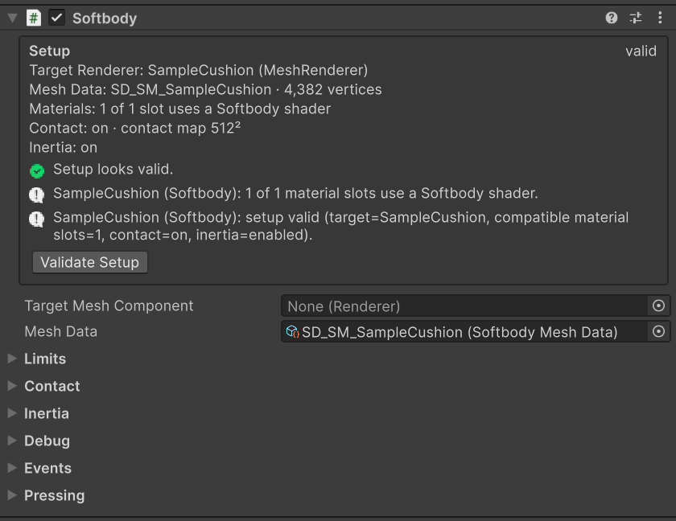
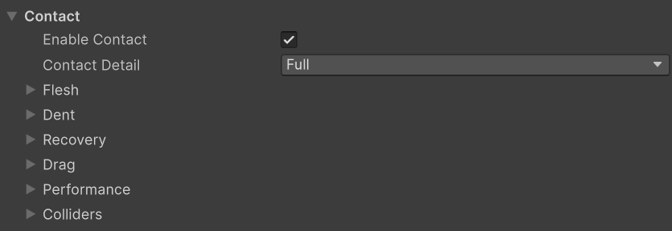
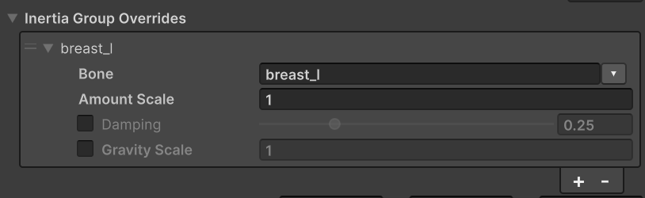

# Softbody Component

Give each mesh one **Softbody** component and set **Mesh Data** to the Baked Data of that mesh's Softbody Authoring Data ([Baking](./Baking)). The mesh's materials must use a Softbody shader ([Materials](./Materials)). The component runs only in Play mode. In Edit mode the mesh draws undeformed.

## Settings {#settings}

Units are cm and seconds, shown after the field name as `(cm)` and `(s)`. "0 to 1": clamped to this range. "Min 0, slider to 2": cannot go below 0; the slider stops at 2, but you can type a larger value. (Advanced): inside the section's Advanced foldout. A field whose condition is not met is dimmed, and its value is kept.

### Setup box {#setup}

The box at the top of the inspector shows what this component will deform.

- **Target Renderer**, **Mesh Data**, **Materials** (how many slots use a Softbody shader), **Contact** (on with the contact map resolution, or why it is off), **Inertia** (on with the number of inertia groups, or why it is off). During Play a line with the current run state is added.
- Below them, each setup problem gets a line, with a button when it can be fixed (**Find** to find the target renderer, **Find Baked Data**, **Use Softbody Materials**, **Open Authoring** to open the authoring asset, **Select** to select the object at fault).
- The **Validate Setup** button checks the setup and writes to the Console. See [Validate Setup](#validate-setup).

### Softbody {#softbody}

| Setting | Default | Description |
|---|---|---|
| [**Target Mesh Component**](#target-mesh-component) | empty | The renderer this component deforms. Empty = picked automatically. |
| **Mesh Data** | empty | The Baked Data of the target mesh's Softbody Authoring Data. |

#### Target Mesh Component {#target-mesh-component}

Takes a Skinned Mesh Renderer or a Mesh Renderer only. When empty, it picks the renderer on this object or its children that has no [Softbody Ignore](./Colliders#softbody-ignore) and uses the mesh Mesh Data was baked from. If none matches, it picks the first renderer.

One renderer is deformed by one Softbody component only. A second component logs a warning and waits until the first one is off.

### Limits {#limits}

| Setting | Default | Description |
|---|---|---|
| [**Max Displacement**](#max-displacement) | 50 cm | The farthest a vertex may move from where it was modeled, with dents and jiggle added together. A safety net; raise it only for very large meshes. Min 0. |

#### Max Displacement {#max-displacement}

Movement is unchanged up to 70% of the limit, then eases into it.

### Contact {#contact}

| Setting | Default | Description |
|---|---|---|
| [**Enable Contact**](#enable-contact) | on | Turns dents on. Turn it off for characters nobody touches. |
| [**Contact Detail**](#contact-detail) | Basic | Basic computes dents and pushed lumps only; Full computes every contact effect: rise, drag, Edge Smoothing and Flex paint. Editable only while Enable Contact is on. |

#### Enable Contact {#enable-contact}

Off removes all contact cost (GPU work, memory, collider searches) and leaves only the jiggle; lumps are no longer pushed either. Can be switched while playing.

#### Contact Detail {#contact-detail}

- **Basic**: only dents and pushed lumps run. Rise, skin drag (and with it the pressing hand's Lump Grip), Edge Smoothing and Flex paint (the bending surface and plates) are off, and their GPU work is skipped. Areas painted in Flex dent like bare skin, and the Console says so when Play starts. In Basic, too, Volume Preservation and Skin Tension change the shape of a dent.
- **Full**: Basic plus rise, skin drag, Edge Smoothing and Flex paint. Use it on meshes seen up close, where the rise, the dragged skin and the plates show.

When this GPU cannot run Full (Metal included), a mesh set to Full runs as Basic and the Console shows `Contact Detail Full cannot run on this graphics device, so this mesh runs as Basic`. The settings of the effects that are off are kept.

### Contact > Flesh {#contact-flesh}

| Setting | Default | Description |
|---|---|---|
| [**Skin Tension**](#skin-tension) | 0 | For flesh covered by a taut skin, such as leather or the pips of a soft die. 0 to 2. |
| [**Volume Offset**](#volume-offset) | 0 | For adjusting, while playing, how much the area around a dent rises. -1 to 1. |
| [**Flex Offset**](#flex-offset) | 0 | For adjusting, while playing, the stiffness of the surface painted in Flex. Not finished yet, so unstable. -1 to 1. |

The width of a dent is set by the baked flesh thickness and **Skin Tension**. How much the flesh rises is set by the authoring asset's **Volume Preservation** times the Volume paint, plus Volume Offset. See [Flesh material](./Concepts#flesh-material).

#### Skin Tension {#skin-tension}

- Values: 0 = bare flesh or jelly, about 0.15 for human skin, about 0.5 for leather; above 1 it is a drumhead over thick flesh.
- The tauter the skin, the rounder and wider the dent, the more it bridges across fingers, and the more the shape of the pressing object blurs. The thinner the flesh, the stronger the effect.
- The same value gives the same skin on any mesh, and Depth paint does not change it.
- It is a stretched skin, not a hard shell, so a stiff area sinks flat instead of tilting like a plate.
- It applies to the whole mesh. To stiffen only part of the surface, paint Flex ([Painting](./Painting#the-four-channels)). Can be changed while playing.

#### Volume Offset {#volume-offset}

It is added to the Volume everywhere (the authoring asset's **Volume Preservation** × the Volume paint), so every spot changes by the same amount whatever was painted. -1 makes everything move like foam, +1 like flesh. How a lump pushed as a whole spreads stays at the baked value. To make an adjustment permanent, put the result into the authoring asset and press Run Bake.

#### Flex Offset {#flex-offset}

**This feature is not finished yet and is unstable. Use it with care.**

It is added to the Flex paint, so a negative value also bends unpainted skin. At -1 every painted piece becomes a rigid plate ([Plates](./Painting#plates)); at +1 all of it is bare flesh. Contact Detail must be Full.

### Contact > Dent {#contact-dent}

| Setting | Default | Description |
|---|---|---|
| [**Max Contact Depth**](#max-contact-depth) | 15 cm | The limit on how deep a collider pushes into the surface. Min 0. |
| [**Edge Smoothing**](#edge-smoothing) | 0.5 | Smooths the dent wall at a collider's edge when Contact Detail is Full. 0 = off. Min 0, slider to 3. |
| [**Dent Darkening**](#dent-darkening) | 0.6 | How much deep, narrow dents (fingertip marks, gaps between fingers) darken. 0 to 1. |

#### Max Contact Depth {#max-contact-depth}

Up to this depth the pressed depth is unchanged; beyond it the depth shrinks smoothly and stops at 1.3 times this value. When a collider sits inside the visible surface (a body capsule a few cm under the skin), set this value to that gap so that what is seen and what is hit have the same shape.

#### Edge Smoothing {#edge-smoothing}

The unit is contact map cells. It smooths steep walls only; flat or lightly pressed areas keep their depth. Editable only while Contact Detail is Full.

- Raise it when a round object such as a finger pressed deep leaves visible steps.
- Lower it when a thin collider such as a finger looks buried or the mark is bumpy. An object thinner than twice this width presses less deep.

#### Dent Darkening {#dent-darkening}

Darkens deep, narrow dents (fingertip marks, gaps between fingers, dent walls); wide presses and shallow dents stay almost unchanged. Visible only in a shader that multiplies the base color by the Softbody occlusion (Softbody/Lit does).

### Contact > Recovery {#contact-recovery}

| Setting | Default | Description |
|---|---|---|
| [**Recovery Rate**](#recovery-rate) | 30 | How fast, per second, dents and dragged skin return after the collider leaves. Min 0.1, slider to 40. |
| [**Memory Time**](#memory-time) | 0 s | The time over which long-pressed flesh keeps a mark, like memory foam. 0 = no mark. Min 0, slider to 10. |
| [**Memory Fade Time**](#memory-fade-time) | 1.5 s | The time for a mark to fade to half. Editable only while Memory Time is above 0. Min 0.05, slider to 10. |

#### Recovery Rate {#recovery-rate}

The same whatever the size of the dent. At 30 it returns almost at once (half in about 0.02 s, done in about 0.15 s); at 8 it takes about 0.5 s and a fast hand leaves a trail. The flesh around the pressed spot takes its shape at once whatever this value is. It does not change the width of the dent.

#### Memory Time {#memory-time}

While pressing, the remaining difference from the pressed shape closes by half every this many seconds. A brief touch leaves almost nothing; a sliding hand leaves a faint trail. While a mark remains, a small gap can show between the skin and a hand that is lifted slowly. For memory foam, try 1.5.

#### Memory Fade Time {#memory-fade-time}

A mark fades to half every this many seconds, also while it is being pressed. So if this value is shorter than Memory Time, even a long press leaves only a shallow mark. The GPU keeps working until the mark has fully faded (about ten times this value).

### Contact > Drag {#contact-drag}

The settings in this section take effect when Contact Detail is Full.

| Setting | Default | Description |
|---|---|---|
| [**Drag Friction**](#drag-friction) | 0.5 | Sets the friction between a moving collider and the skin when Contact Detail is Full. 0 = off. Min 0, slider to 2. |

#### Drag Friction {#drag-friction}

A multiple of the pressing strength. The skin moves with the hand and slips once the pull of the flesh exceeds this. At 0.5, a hand pressing 2 cm flesh by 1 cm drags the skin about 0.7 cm, and gripping harder adds only a little more. A stopped hand holds the skin. The drag is the same whether the same distance is swept fast or slow. It also limits how hard a gripping hand drags a lump (Lump Grip). At 0 the drag costs nothing. Editable only while Contact Detail is Full.

### Contact > Performance {#contact-performance}

| Setting | Default | Description |
|---|---|---|
| [**Min Screen Size**](#min-screen-size) | 0.15 | Stops the dent calculation of a mesh seen far away, to save GPU time. Min 0, slider to 1. |

#### Min Screen Size {#min-screen-size}

While the mesh appears smaller than this on screen, the dent calculation stops. Dents ease back as if released, and then the GPU work stops. When the mesh appears about 20% larger than this value, it calculates again. A mesh no camera sees and a mesh no collider touches stop the same way. Jiggle is not affected.

- The unit is the bounds diameter divided by the screen height, and the largest value over all cameras, the Scene view included, is used.
- It measures the whole mesh, so a smaller mesh stops earlier. At 0.15 with a 90° horizontal field of view, a human-size character stops at about 12 m, but a 12 cm block stops at about 1.2 m. At 12 m, a 1 cm dent is about 1 pixel at 1080p.
- Lower it if small props must dent from farther away (at 0.05 a block stops at about 3.7 m). More meshes then calculate at the same time.
- 0 = never stops because of size.

### Contact > Colliders {#contact-colliders}

| Setting | Default | Description |
|---|---|---|
| [**Find Colliders Automatically**](./Colliders#what-can-press-the-flesh) | on | Every frame, finds the colliders overlapping the mesh and lets them press. Off = outside colliders are ignored. |
| [**Use Shape Fields**](./Colliders#shape-fields) | on | A hand or prop with a Softbody Shape Field presses with its baked real shape, and the colliders under it do not press. Off = for comparison, they press with those colliders. |
| **Collider Channel** | all layers except Ignore Raycast | The layers searched for colliders. Every collider on these layers presses the flesh. A shape field is judged by the renderer's layer. |
| **Ignore Root** (Advanced) | empty | Colliders under this object do not press this mesh. When empty, the nearest parent Animator, or this object if there is none. So a character's own bone colliders do not press its own flesh. |

For what can press and the per-frame collider limit, see [Colliders](./Colliders).

### Inertia {#inertia}

| Setting | Default | Description |
|---|---|---|
| **Enable Inertia** | on | Turns jiggle on. When the body or mesh speeds up, turns, stops or tilts, the flesh lags behind and wobbles back. |
| [**Inertia Amount**](#inertia-amount) | 2.5 cm | How soft the flesh is. Think of it as the length of a jiggle bone (big jiggling lump flesh: 10 to 20). Min 0. |
| **Inertia Damping** | 0.25 | How many times the jiggle swings over before it stops. At 0.25 about two swings, at 0.4 about one, near 0.1 about seven. It does not change the speed. 0.01 to 0.99. |
| [**Jiggle Speed**](#jiggle-speed) | 1 | Changes only the rhythm of the jiggle and keeps its size. 2 is twice as fast. Min 0.1, slider 0.25 to 4. |
| [**Inertia Group Overrides**](#inertia-group-overrides-entry) | empty | Sets the amount, damping and gravity of one inertia group (one bone) separately. The fields are in the table below. |
| **Inertia Direction Scale** | 1, 1, 1 | Scales the size of the jiggle along the mesh's modeled axes (local X, Y, Z). For example, more up-down on landing, less sideways when turning. It does not apply to rotational movement. |
| [**Inertia Firmness**](#inertia-firmness) | 0 | Tightens the flesh in large movements, such as a body that runs and stops. Start around 1. 0 = off. Min 0. |
| [**Gravity Scale**](#gravity-scale) | 1 | The strength of gravity pulling lumps (flesh hanging on Lump bones) (1 = real gravity, 0 = off). Min 0. |
| [**Max Inertia Offset**](#max-inertia-offset) | 25 cm | The safety limit on how far the jiggle may move a vertex, applied per inertia group. Min 0. |
| **Actor Motion Weight** | 1 | How strongly the object's movement and rotation make the flesh jiggle (1 = real acceleration). Raise it for a bigger jiggle at the same speed. It does not multiply the tilt sag. Min 0. |
| **Animation Motion Weight** | 1 | How strongly animation moving the bones makes the flesh jiggle (1 = real acceleration). Min 0. |
| **Hitch Guard** | 0.1 s | A frame longer than this counts as a hitch and its acceleration is ignored. 0.01 to 1. |
| [**Teleport Distance**](#teleport-distance) | 50 cm | If the object moves this much farther in one frame than its current speed allows, it counts as a teleport and the flesh does not jiggle. Min 0. |

#### Inertia Amount {#inertia-amount}

The distance thick flesh painted white in Jiggle (the reference flesh) sags under a steady 1 g push; it means the same flesh on any character. Firmer or thinner areas move less according to the bake and the Jiggle paint. To reduce only one part, use Inertia Group Overrides or the Jiggle paint.

Each part jiggles at a speed that matches its own sag: sag 10 cm = 1.6 Hz, 2.5 cm = 3.2 Hz. To change only the speed, use Jiggle Speed.

#### Jiggle Speed {#jiggle-speed}

At 2 the jiggle is twice as fast and settles in half the time; at 0.5 it is half as fast. The bounce height on landing or a sudden stop and the sag when the body tilts stay the same. The number of swings is still set by Damping.

#### Inertia Firmness {#inertia-firmness}

The higher it is, the earlier it tightens. At 1 the jiggle halves at a push of gravity's size (1 g); at 2, at half of that. The jiggle does not exceed Inertia Amount ÷ this value (cm). Small movements stay loose. At 0 it is off and the jiggle grows with the movement.

#### Gravity Scale {#gravity-scale}

The mesh is assumed to be modeled upright as imported, with the sag of standing already in its shape. So at 1 it sags only when the body tilts or lies down. Above 1 it sags more even when standing, by the extra gravity; below 1 only the sag when tilting is reduced. Lumps and static meshes follow this value. Parts attached to the skeleton, such as the torso and limbs, do not sag, so belly and back flesh does not slide over the bone. To make one such part sag, give it a Gravity Scale in Inertia Group Overrides. A static mesh placed at an angle keeps sagging by that angle; set 0 if you do not want that.

#### Max Inertia Offset {#max-inertia-offset}

For a static mesh it applies to the whole mesh. It is unchanged up to 70% of the limit and eases into it beyond. Only what is drawn is cut off, so at the limit the peak of a movement flattens instead of popping. To change the feel of large movements, use Inertia Firmness. Large lumps on a large character can reach the default; raise it then.

#### Teleport Distance {#teleport-distance}

Turning more than 45 degrees beyond the current rotation speed also counts as a teleport. Code that sets `transform.position` directly, respawns and animation cuts fall under this. A sudden stop such as a landing still jiggles. At 0, only movement announced with [`NotifyTeleported()`](#scripting) counts as a teleport.

#### Inertia Group Overrides entry {#inertia-group-overrides-entry}

Entries are told apart by bone name. **Bone** is chosen from a dropdown of the inertia groups the bake found. A field with a checkbox in front is used only when checked. Parts not in the list and unchecked fields use the values above. If the same bone is listed twice, only the first entry is used, and a warning appears under the list.

| Setting | Default | Description |
|---|---|---|
| **Bone** | empty | The inertia group (a bone the bake found) that receives these settings. |
| **Amount Scale** | 1 | Multiplies this part's Inertia Amount. A part that moves more jiggles more slowly. 0 = no jiggle. Min 0. |
| **Damping** (check to use) | 0.25 | This part's Inertia Damping, that is, the number of swings before it stops. 0.01 to 0.99. |
| **Gravity Scale** (check to use) | 1 | The strength of gravity pulling this part (1 = real gravity, 0 = none, above 1 it sags more even when standing). For this part it replaces Gravity Scale, so a part attached to the skeleton can sag too. Min 0. |

For how to tune, see [Inertia](./Inertia).

### Inertia > Lumps {#inertia-lumps}

| Setting | Default | Description |
|---|---|---|
| [**Lump Yield**](#lump-yield) | 1 | How much a whole lump is pushed sideways when pressed. 0 = it only dents. Min 0, slider to 4. |
| [**Lump Grip**](#lump-grip) | 1 | How hard a hand holding the lump's skin drags the lump. 0 = off. Min 0, slider to 4. |
| [**Squeeze Stiffening**](#squeeze-stiffening) | 3 | How much harder the flesh pushes back when squeezed deep. 0 = proportional to depth. Min 0, slider to 6. |

Lumps exist only on bones set to **Lump** in Bone Overrides when a skinned mesh is baked ([Baking](./Baking)). A static mesh has no lumps.

#### Lump Yield {#lump-yield}

A fingertip poke mostly dents; a wide, deep push with a palm moves the lump; a hand that goes deeper than the flesh thickness (gripping around it or lifting from below) carries the lump away. What counts as a fingertip or a palm is set by the size of the collider ([Hand size that pushes lumps](./Colliders#presser-size)). 1 = it moves as much as the baked softness allows, and the higher the value, the more easily it moves. Parts attached to the skeleton (belly, back) and static meshes do not move as lumps. Enable Contact and Enable Inertia must be on, and Inertia Amount must be above 0.

#### Lump Grip {#lump-grip}

With a light fingertip grip the skin slips; with a wide, deep grip the lump is dragged until the flesh under it pulls harder than the friction, and then it slips. 1 = it drags as firmly as the flesh resists the press, and the higher the value, the harder it drags. Lump Yield and Drag Friction must be above 0, Contact Detail must be Full, and Enable Inertia must be on.

#### Squeeze Stiffening {#squeeze-stiffening}

At 3 the flesh is about 2.3 times as stiff at half the flesh thickness and 6 times as stiff at the full thickness. At 5 it is about 4 times and 30 times. A shallow press is barely affected. So a tight grip stretches the skin only a little while pushing and dragging the lump harder. If the lump is pushed too far by a deep press, lower Lump Yield. It affects only pushed lumps and skin drag (Contact Detail Full, with Drag Friction above 0).

### Debug {#debug}

| Setting | Default | Description |
|---|---|---|
| **Debug View** | off | Shows a debug color (Debug View Mode) on Softbody materials instead of normal shading. Can be changed while playing. |
| [**Debug View Mode**](#debug-view-mode) | 0 | Chooses what the debug color shows. Editable only while Debug View is on. 0 to 5. |
| **Contact Only (Debug)** | off | Turns all jiggle off and shows contact only. Not for release. While it is on, Validate Setup does not require jiggle data. |

The Debug View section of the [Softbody Debugger](./Project-Settings#debug-view) can also change these two values for the selected component.

#### Debug View Mode {#debug-view-mode}

- 0: how well each vertex sits inside the measured flesh (green is inside, yellow is estimated, red is failed).
- 1: connection to the rigid core (cyan is connected, magenta is not connected).
- 2: contact map checker. Layered clothing and buttons with the same pattern as the skin below dent together with the skin. A line where the pattern breaks is a seam.
- 3: distance to the outer surface (green is on the surface, red is far outside, blue is depth inside; the color is deepest at 10 cm).
- 4: baked softness (navy does not move, then green, red is softest; magenta moves in the opposite direction).
- 5: dent between vertices (green reads the dent inside the triangle, red reads it only at the vertices along a seam).

### Events {#events}

| Event | Description |
|---|---|
| **On Softbody Updated** | Called once per frame, after the dents and jiggle are updated and sent to the material. |

### Pressing {#pressing}

The section at the very bottom of the inspector. **Create Bone Colliders** makes a collider for each bone of the target Skinned Mesh Renderer, so that this character presses other Softbody meshes with its body. It can press in Edit mode only. See [Softbody meshes pressing each other](./Colliders#softbody-meshes-pressing-each-other).

## Turning the component off and on {#turning-the-component-off-and-on}

Switching the component's checkbox or its GameObject off and on turns the component fully off and on.

- Off: updates, collider searches and GPU work all stop. The jiggle state and the drag record are cleared, and the mesh shows its modeled shape. The material copy is kept and given the off values, so the vertex stage of the Softbody shader keeps running lightly. The contact textures stay in memory for [Release Delay](./Project-Settings#release-delay) (default 10 seconds) and are then released a little each frame. The contact map (the texture in Mesh Data) stays in memory while off.
- On: it starts from rest, so if the object or a collider moved while it was off, the flesh does not jump and the skin is not dragged. It does not create render textures or materials in that frame. Within Release Delay nothing is recreated; after it, textures are created a few per frame, so for a few frames the mesh only jiggles and does not dent.
- A component that starts Play off checks the setup and creates the material copy the first time it is turned on.
- Removing the component or ending Play returns the renderer to its original materials and bounds.

To remove only the contact cost and keep the jiggle, turn off **Enable Contact**. This also puts contact to sleep instead of deleting it, so turning it on again within Release Delay recreates nothing.

## Validate Setup {#validate-setup}

The **Validate Setup** button in the Setup box (or **Validate Setup** in the component's ⋮ menu) checks the setup and writes problems to the Console. Play runs the same check when it starts.

- It checks whether the target mesh matches Mesh Data (vertex count and mesh fingerprint — whether it was reimported or edited after the bake), whether a submesh has a base vertex offset, whether the bones are the same as at bake time, whether it is tied into static batching, whether there is a Softbody shader slot, and whether there is jiggle data.
- It also reports settings that do nothing on this mesh (Inertia Group Overrides on a static mesh, Lump Yield on a mesh without lumps, a Volume Offset that gets clipped at the end, and so on). Validate Setup lists all of them; Play lists only the ones changed from the default. The messages and how to fix them are in [Troubleshooting](./Troubleshooting#validate-reports-problems).
- The Setup box also warns about things visible only in the editor: a renderer inside an LOD Group (only LOD0 is deformed), a Batching Static mark, GPU Resident Drawer, and a model whose Skin Weights is Standard (4 bones per vertex).

## Project Settings > Softbody {#project-settings-softbody}

The update rate, the number of meshes updated per frame, and the speed at which contact textures are created and released are project-wide settings. See [Project Settings](./Project-Settings).

## Scripting {#scripting}

`Softbody.SoftbodyComponent`.

- All the settings above are public fields. A value changed during Play is applied at the next update, and changing Target Mesh Component or Mesh Data sets the component up again on the next frame. Fields whose name differs from the display name:

  | Display name | Field |
  |---|---|
  | Enable Contact, Enable Inertia | `bEnableContact`, `bEnableInertia` |
  | Edge Smoothing, Dent Darkening | `SurfaceEdgeTrim`, `SurfaceOcclusionStrength` |
  | Recovery Rate, Memory Time, Memory Fade Time | `SurfaceRecoveryRate`, `SurfaceMemoryTime`, `SurfaceMemoryFadeTime` |
  | Drag Friction, Min Screen Size | `SurfaceDragRatio`, `SurfaceMinScreenSize` |
  | Find Colliders Automatically, Use Shape Fields | `bAutoDiscoverPressure`, `bUseColliderFields` |
  | Inertia Firmness, Gravity Scale, Max Inertia Offset | `InertiaSaturation`, `InertiaGravityScale`, `InertiaMaxOffset` |
  | Actor Motion Weight, Animation Motion Weight | `ComponentInertiaWeight`, `AnimationInertiaWeight` |
  | Squeeze Stiffening, Hitch Guard | `LumpStiffen`, `AccelerationDtGuard` |
  | Debug View, Debug View Mode, Contact Only (Debug) | `bDebugVis`, `DebugVisMode`, `bContactOnlyValidation` |

- `bool ValidateSetup()`: the same as [Validate Setup](#validate-setup). Returns true when there is nothing to fix.
- `void NotifyTeleported()`: reports this frame's movement as a teleport. The next jiggle calculation is not shaken by that movement. Works separately from Teleport Distance.
- `Renderer ResolveTargetRenderer()`: the target renderer found by the current rules (whether assigned or found automatically).
- `string[] GetInertiaGroupBoneNames()`: the names usable for Bone in Inertia Group Overrides.
- `OnSoftbodyUpdated` (UnityEvent) and `Updated` (C# event): called once per frame after the dents and jiggle are sent to the material.
- The component runs in LateUpdate with execution order 10000, so it reads the bone pose moved by animation and most scripts.
- The Quality values in Project Settings > Softbody can be overridden during Play with `SoftbodySystem.Overrides` ([Quality levels](./Project-Settings#quality-levels)).
